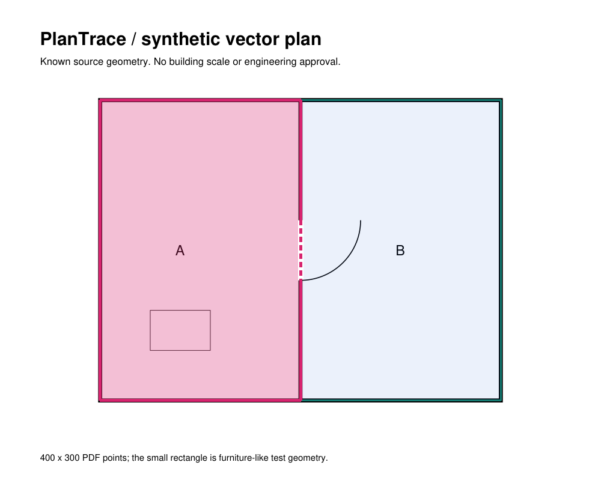
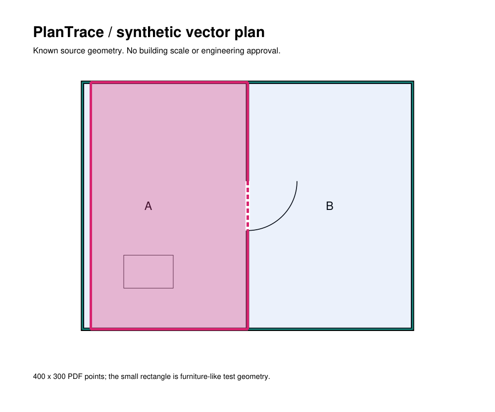

# PlanTrace

An evidence-backed prototype for reviewing **room geometry and calibrated geometric areas from vector floor plans**.

The focused workflow is: extract candidates, inspect source-aligned overlays, associate known dimensions, correct a wall, invalidate the old room area, explicitly reconstruct a supported room, and export a versioned provisional model.

**Controlled example:** a room starts at **6.0 m²**, its area is withheld after a wall correction, and an explicit rebuild recovers **5.7 m²**. The rebuilt geometry retains manual/inferred boundaries and remains unverified.

| Extracted room | Reconstructed after correction |
| --- | --- |
|  |  |

Both images show a generated synthetic plan. The original PDF is retained; coloured overlays show candidate geometry and the manual correction. These are not real-plan validation results.

## Run locally

Python **3.11** is the tested runtime. In PowerShell, from a fresh checkout:

```powershell
python -m venv .venv
.\.venv\Scripts\python.exe -m pip install -e ".[dev]"
.\.venv\Scripts\python.exe -m streamlit run app.py
```

Open the URL printed in the terminal. On macOS/Linux, use `.venv/bin/python` for the equivalent commands. The recorded test run used Windows; other platforms have not been validated here. Node is optional and used only for frontend tests.

## Review workflow

1. Select **Use synthetic example**, or upload a vector PDF. Select a page and candidate to inspect its geometry, raw source paths and evidence. Raster inputs currently provide previews without automatic geometry extraction.
2. Under **Scale calibration and regions**, select reference endpoints using the local JavaScript picker or source-coordinate entry. Supply an explicit unit, distance and evidence provenance.
3. For the included synthetic example only, associate `(100,100)–(500,100)` with **4 m**, and `(100,100)–(100,400)` with **3 m**. These are declared demonstration assumptions, giving 0.01 m/drawing point. They are not dimensions recovered from the drawing.
4. Inspect a wall length or nominal polygon area. Reference agreement, independent correctness and structural completeness are separate statuses.
5. Select the automatic left wall `(100,100)–(100,400)` and enter `[[110,100],[110,400]]` under **Manual coordinate correction**. Its dependent room area becomes unavailable.
6. Select the original automatic left room. Enter **Room rebuild reviewer** and **Room rebuild reason**, then choose **Rebuild room from current walls**. A uniquely supported face recovers a nominal **5.7 m²**; ambiguity or missing closure produces an explicit refusal.
7. Review structurally supported candidates and commit them as provisional under **Topology and provisional building model**. Download page evidence or versioned model JSON. After restarting, choose **Saved drawing** to restore the review.

Local source bytes, calibration, corrections, decisions and model versions are stored in `data/plantrace.sqlite3`, which is excluded from version control. `PLANTRACE_DB_PATH` selects another local database. Review identities and physical-reference metadata are manually declared, not authenticated.

## Reproduce the evidence

```powershell
.\.venv\Scripts\python.exe -m pytest -q
node --test tests/test_point_picker.mjs
.\.venv\Scripts\python.exe -m scripts.demonstrate_room_rebuild
.\.venv\Scripts\python.exe -m scripts.evaluate_stage6
```

Each workflow creates a new output directory under `support/artifacts/`; existing nonempty directories are refused. Generated databases and run outputs are not tracked.

- [Architecture and geometry decisions](docs/ARCHITECTURE.md)
- [Validation, denominators and limitations](docs/VALIDATION.md)
- [Recorded room correction case](support/evaluation/reports/room_rebuild.json)
- [Recorded evaluation](support/evaluation/reports/stage6.json)
- [Synthetic dataset manifest](support/evaluation/fixtures/manifest.json)
- [Exact Windows/Python dependency snapshot](support/reproducibility/requirements-lock.txt)

## Scope

This is a deterministic geometry/review prototype. It uses Python, Streamlit, PyMuPDF, Shapely/GEOS, Pydantic, Pillow, SQLite and a local HTML Canvas point picker. It has no LLM, trained model, paid API or cloud service dependency.

The regression suite contains **216 Python tests and 6 JavaScript tests**. Validation uses controlled synthetic geometry. **No independent real architectural drawing has been evaluated.** Decorative linework and missed partitions still cause false/missed candidates; room reconstruction conservatively rejects ambiguous cases. Room-area approval is blocked because structural completeness is not established. Engineering handoff is explicitly unavailable. No production readiness or engineering safety is claimed.
