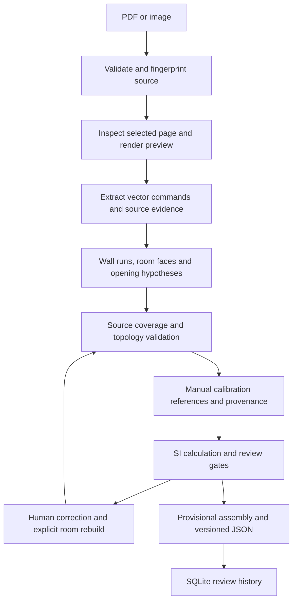

# Geometry, measurements and review

PlanTrace preserves evidence across a deterministic source-to-review pipeline. It separates an extracted candidate from a committed provisional entity, and numerical agreement from independent correctness or engineering handoff.



## Source frame and candidate extraction

`documents.py` inventories page dimensions, CropBox/MediaBox, original rotation and source SHA-256. Geometry is kept in unrotated CropBox-local PDF points, with top-left origin, x right and y down. Previews use an explicit affine transform; the point picker applies its inverse, so display zoom does not change source coordinates.

`candidates.py` filters stroked paths, nodes intersections, merges collinear runs and links output segments to original drawing commands. Shapely polygonization reconstructs enclosed faces. Size/span, source-path and ambiguity checks reduce obvious non-room shapes, but do not establish architectural semantics.

Missing-ink bridges remain separate hypotheses. Small supported endpoint gaps can use configurable tolerance bridges; larger flanked gaps need compatible source cues to support a provisional closure. Openings remain unresolved; a flanking segment is not a confirmed continuous door/window host.

`source_audit.py` compares current wall runs with actual source strokes. Significant unexplained partial lines reaching room boundaries can trigger a suspected missed-wall warning. Small/closed graphics remain ambiguous. A wholly absent source partition cannot be recovered from geometry alone.

## Calibration and SI calculations

```text
scale = reference_distance_in_metres / reference_length_in_drawing_units
wall_length_m = drawing_length × scale
polygon_area_m2 = drawing_area × scale²
```

Area means polygon exterior minus explicit holes, using candidate centreline boundaries. No gross, net, usable or legal floor-area convention is asserted.

References record an explicit unit and establishment method: manual assumption, source annotation or declared independently verified physical reference. Independent support needs distinct physical evidence records/error-source groups, with explicit physical units. Shared groups, records or hashes cannot create independent proof. A diagnostic tolerance cannot override the separate measurement-review disagreement cap.

Evidence declarations are not authenticated. Two consistently wrong inputs can agree, and deliberately false provenance can still pass measurement review. Numeric residuals and gate outcomes therefore remain visible. Room completeness stays unestablished, room-area approval remains blocked and engineering handoff is disabled.

## Explicit room reconstruction after correction

See [`room_rebuild.py`](../plantrace/room_rebuild.py) and [its regression tests](../tests/test_room_rebuild.py).

1. Select an original automatic room and collect current nonsuperseded walls.
2. Retain only existing hypothesis bridges whose supporting candidates are still active. Do not invent, stretch or snap new walls to close a room.
3. Reject invalid/overlapping inputs and apply the existing segment/noding budgets.
4. Node the current network with `unary_union`, then derive faces using `polygonize_full`.
5. Find a unique face containing the original interior point. Reject overlap with other rooms and unassigned extra faces that would silently split the old room.
6. Preserve holes and apply size/span checks. Create a separate unresolved manual candidate with source evidence and supersession lineage.
7. Bind the reconstruction to original geometry, current wall versions, bridge versions and configuration. A later change invalidates that basis and withholds its area again.

The synthetic correction case produces **6.0 → unavailable → 5.7 m²**. Its rebuilt perimeter contains automatic source-stroke segments, a manually moved wall and an explicit hypothesis bridge; these are provenance lengths, not a probability of correctness.

Large remodels and ambiguous split/merge cases still need manual review. Recovering a valid geometric face does not verify architectural completeness or approve its area.

## Persistence and interfaces

SQLite stores original sources, immutable workspace snapshots, geometry versions, calibration/measurement evidence, review events and model versions. Write transactions and revision/context checks reject stale concurrent edits. Hashes bind snapshots and dependencies; they are integrity checks, not authenticated signatures.

`PlanTraceService` provides deterministic `list_candidates()`, `select_candidate()`, `link_opening_to_wall()`, `validate_model()` and `commit_entities()` interfaces. A JSON-schema dispatcher exposes those methods without an agent framework. Committed models are provisional, include only supported relationships, and preserve inferred/unresolved flags.

The local point picker uses plain JavaScript and HTML Canvas with a Streamlit component protocol. No frontend build is needed.
